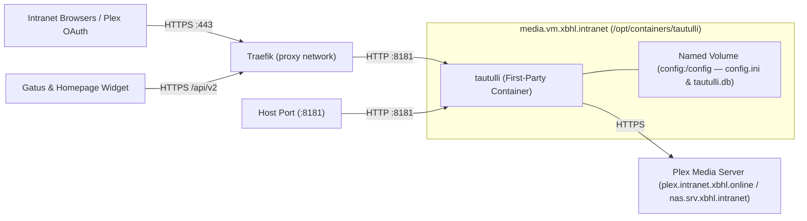

# Tautulli

> Version: `v2.18.2` | Image: `ghcr.io/tautulli/tautulli:v2.18.2` | Upstream: https://github.com/Tautulli/Tautulli

Python-based monitoring, analytics, and notification web application for Plex Media Server (`plex.intranet.xbhl.online`).

## Service Overview

| Property | Value |
| :--- | :--- |
| **Domain** | `https://tautulli.intranet.xbhl.online` |
| **Primary Node** | `media.vm.xbhl.intranet` (`Proxmox VM`) |
| **Deploy Path** | `/opt/containers/tautulli` |
| **Ingress Strategy** | Direct (`Traefik` `websecure` -> `tautulli:8181` on external `proxy` network; Cloudflare DNS `direct`) + host port `8181:8181` |
| **Topology Archetype** | Standalone Application |
| **Authentication** | Native Web UI / Plex OAuth (`/api/v2` authenticated via Tautulli API key; no Authelia ForwardAuth or OIDC) |
| **Ecosystem** | WUD tracks `tautulli` (`^v\d+\.\d+\.\d+$`); Gatus monitors `tautulli-connection-status` (`/api/v2?cmd=status`) and `tautulli-container-status` (`src/config/tautulli.yaml`); Homepage `Media` group tile (`server: media`, `container: tautulli`, `tautulli` widget); no Authelia OIDC client or ForwardAuth middleware |

## Architecture & Communication

- **First-Party Container & Privilege Drop**: Runs the official first-party `ghcr.io/tautulli/tautulli` image (not `lscr.io/linuxserver/tautulli`) as a single container on `media.vm.xbhl.intranet`. Inline `environment:` sets `PUID=1000`, `PGID=988`, and `TZ=Europe/Warsaw`; upstream `start.sh` (`TAUTULLI_DOCKER=True`) maps the internal `tautulli` user and group to `1000:988`, updates ownership on `/config`, and drops privileges via `gosu` before executing `python Tautulli.py --datadir /config`. Persistent state (`config.ini`, embedded SQLite `tautulli.db`, logs, and backups) resides in the named Docker volume `config:/config`.
- **Direct Ingress & Unmediated API Access**: Joins only the external `proxy` Docker network (no internal sidecar network), exposing `https://tautulli.intranet.xbhl.online` through Traefik (`tautulli-router` on `websecure` -> container port `8181`) while also publishing host port `"8181:8181"` on `media.vm.xbhl.intranet`. Traefik `authelia@file` ForwardAuth middleware is intentionally omitted so Plex OAuth callbacks, Gatus (`tautulli-connection-status` polling `/api/v2?apikey=${TAUTULLI_API_KEY}&cmd=status`), and the Homepage `tautulli` widget (`HOMEPAGE_VAR_TAUTULLI_API_KEY`) can reach Tautulli directly.
- **Plex Monitoring & Runtime Configuration**: Connects outbound over HTTPS to Plex Media Server (`https://plex.intranet.xbhl.online` on `nas.srv.xbhl.intranet`) to track playback sessions, library metadata, and viewing history. All Plex connection settings and API keys are managed via the Tautulli Web UI in `/config/config.ini` rather than `TAUTULLI_*` environment overrides (which lock overridden keys read-only in upstream `plexpy/config.py`).
- **Upstream Healthcheck & CI Verification**: `src/docker-compose.yml` omits a custom `healthcheck:` definition, inheriting the upstream `Dockerfile` `HEALTHCHECK` (`--start-period=90s`, probing `https://localhost:8181/status` with fallback to `http://localhost:8181/status` via `curl`). `.gitlab-ci.yml` consumes the `docker-compose-service-deployment` component with zero custom job overrides, relying on the default `90`s `--wait-timeout` during DinD testing (`test:tautulli:docker-compose`) and deployment (`deploy:tautulli:start-service`) before `verify:tautulli:healthcheck` asserts `.State.Health.Status == "healthy"`.

## Required GitLab CI/CD Variables

| Scope | Variable(s) | Target / Consumer | Purpose |
| :--- | :--- | :--- | :--- |
| **Project (`home-lab/tautulli`)** | *(None)* | — | No `.env` file or `setup:generate-build-artifacts` job; `TAUTULLI_API_KEY` and `HOMEPAGE_VAR_TAUTULLI_API_KEY` live in `home-lab/gatus` and `home-lab/homepage`. |
| **Group-Inherited (`home-lab`)** | `SSH_USER`, `SSH_PRIVATE_KEY` | `docker-compose-service-deployment` | SSH deployment credentials for `media.vm.xbhl.intranet`. |
| **Group-Inherited (`home-lab`)** | `CLOUDFLARE_ZONE_ID`, `CLOUDFLARE_DNS_API_TOKEN` | `docker-compose-service-deployment` | Cloudflare DNS `direct` record management for `tautulli.intranet.xbhl.online`. |

## Upgrades & Maintenance

- **Upstream & Wrapper Sources**: Standard (tracked via `wud.link.template`).
- **Version & Flavor Constraints**: Official first-party `ghcr.io/tautulli/tautulli` image (not `lscr.io/linuxserver/tautulli`) locked to `v`-prefixed SemVer tags (`^v\d+\.\d+\.\d+$$`); uses embedded SQLite (`/config/tautulli.db`) with no external database container.
- **Intentional Choices (Do Not Propose)**: Inline `PUID`/`PGID`/`TZ` in `src/docker-compose.yml` with no `.env` file, CI secret injection, or `TAUTULLI_*` env overrides (which lock keys read-only in `plexpy/config.py`; Plex connection and API keys are managed via Web UI in `/config/config.ini`, per MRs `!4` and `!7`); omits `authelia@file` middleware on `tautulli-router` and publishes host port `8181:8181` so Plex OAuth, Gatus (`tautulli-connection-status` on `/api/v2?cmd=status`), and the Homepage `tautulli` widget remain unblocked; omits Compose `healthcheck:` in favor of the upstream image `HEALTHCHECK`.
- **Upgrade & CI Gotchas**: `delete-existing-container-files: true` wipes `/opt/containers/tautulli` on every deploy, so `/config` (`config.ini`, `tautulli.db`, backups) must remain on named Docker volume `config:/config` (never relative bind mounts); CI (`docker compose up --wait` with default `90`s timeout + `verify:tautulli:healthcheck`) and Gatus (`tautulli-container-status`) both require `.State.Health.Status == "healthy"`, so if upstream ever drops or slows its `Dockerfile` `HEALTHCHECK --start-period=90s` (`curl` on `localhost:8181/status`), add an explicit Compose `healthcheck` or raise `container-healthcheck-delay`.
