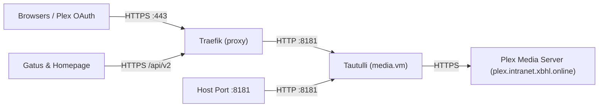

# Tautulli

> Version: `v2.18.2` | Image: `ghcr.io/tautulli/tautulli:v2.18.2` | Upstream: https://github.com/Tautulli/Tautulli

Activity monitoring, playback analytics, and viewing history service for Plex Media Server (`plex.intranet.xbhl.online`).

## Overview

| Property | Value |
| :--- | :--- |
| **Domain** | `https://tautulli.intranet.xbhl.online` |
| **Node** | `media.vm.xbhl.intranet` |
| **Ingress** | Traefik `websecure` TLS on `proxy` network (`:8181`) + host port `8181:8181` (Cloudflare DNS `direct`) |
| **Authentication** | Native Web UI / Plex OAuth + Tautulli API key on `/api/v2` (no Authelia ForwardAuth or OIDC) |
| **Ecosystem** | Monitored by WUD and Gatus (`/api/v2?cmd=status` + container health); Homepage `Media` widget |

## Architecture & Key Decisions

- **Plex Activity & History Analytics**: Runs the official first-party `ghcr.io/tautulli/tautulli` container on `media.vm.xbhl.intranet` with an embedded SQLite database, polling `plex.intranet.xbhl.online` (`nas.srv.xbhl.intranet`) over HTTPS to record active streams, library metadata, and playback history.
- **Unmediated Traefik TLS & Plex OAuth**: Exposes `tautulli.intranet.xbhl.online` directly via Traefik `websecure` TLS (plus host port `8181:8181`) without `authelia@file` ForwardAuth middleware so Plex OAuth callbacks and API consumers are not intercepted.
- **UI-Managed Config & Ecosystem API**: Manages Plex server binding and API credentials through Tautulli's Web UI rather than `TAUTULLI_*` environment overrides (which lock settings read-only upstream), serving `/api/v2` metrics and health checks to the Homepage widget and Gatus (`?cmd=status`).

## Upgrades & Maintenance

- **Upstream & Wrapper Sources**: Upstream releases at `https://github.com/Tautulli/Tautulli/releases` (tracked via `wud.link.template`).
- **Version & Flavor Constraints**: Official first-party `ghcr.io/tautulli/tautulli` image (not `lscr.io/linuxserver/tautulli`) pinned to `v`-prefixed SemVer tags (`^v\d+\.\d+\.\d+$`) with embedded SQLite.
- **Intentional Choices (Do Not Propose)**: Inline container user/timezone config with no `.env` file or `TAUTULLI_*` overrides; omits `authelia@file` middleware and keeps host port `8181:8181` for Plex OAuth, Gatus, and Homepage API access; relies on the upstream image `HEALTHCHECK` without a custom Compose `healthcheck:`.
- **Upgrade & CI Gotchas**: Both CI (`verify:tautulli:healthcheck`) and Gatus (`tautulli-container-status`) assert `.State.Health.Status == "healthy"` via the inherited upstream `Dockerfile` `HEALTHCHECK` (`localhost:8181/status`); add an explicit Compose `healthcheck` if upstream changes or drops it.
